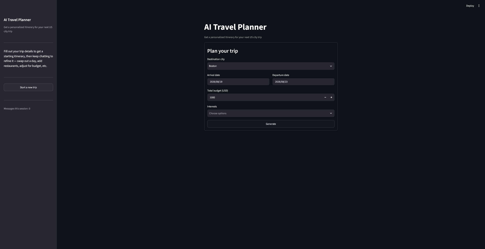

# COMP-470 Travel Agent — AI Travel Planner

Team Project | COMP 470
Group project analyzing data for 5 U.S. cities: Boston, New York City, Chicago, Washington DC, and Orlando.

## Authors

- Matthew Madden
- Jarred Yung
- Nathan Fairhurst
- Destin Ng

## Overview

A Retrieval-Augmented Generation (RAG) chatbot that creates personalized travel itineraries. Users provide a destination city, travel dates, budget, and interests through a Streamlit interface, and the assistant generates a day-by-day itinerary using real travel-guide data (PDFs and structured text files) and a local LLM (Ollama).

## Screenshots



## Features

- Conversational trip-planning interface with multi-turn follow-up chat
- RAG pipeline: retrieves relevant travel-guide content before generating a response
- Source attribution — shows which document/page each answer is based on
- Input validation (dates, budget, required fields) with error handling
- Covers 5 cities: Boston, NYC, Chicago, Washington DC, Orlando

## Requirements

- Python 3.10+
- Ollama (with `llama3.2:3b` model pulled)
- Dependencies listed in `requirements.txt`

## Install Ollama

1. Download from https://ollama.com/download
2. Verify installation:
```bash
ollama --version
```
3. Pull the model:
```bash
ollama pull llama3.2:3b
```

## Run Locally

Clone the project
```bash
git clone https://github.com/JYung04/COMP-470TravelAgent
```

Go to the project directory
```bash
cd COMP-470TravelAgent
```

Install dependencies
```bash
pip install -r requirements.txt
```

Start Ollama (in a separate terminal, or in the background)
```bash
ollama serve &
```

Start the app
```bash
streamlit run app.py
```

> **First run note:** the app needs a populated knowledge base to answer questions. If `travel_database/` doesn't exist yet, run `python Init.py` first (or let the app build it automatically on first launch) to load and embed the travel-guide data.

## Project Structure

| File | Purpose |
|---|---|
| `app.py` | Streamlit UI — trip form, chat interface |
| `backend.py` | Connects the UI to the RAG pipeline and Ollama |
| `rag.py` | Loads PDFs/TXT files, chunks, embeds, and retrieves relevant content |
| `database.py` | ChromaDB vector storage (add/search/count) |
| `embed.py` | Wraps the sentence-transformers embedding model |
| `Init.py` | One-time setup to build the knowledge base |

## Known Limitations

- **Structured data chunking:** files with many short records (e.g. `restaurants.txt`, `hotels.txt`) are currently chunked with the same fixed word-count method used for prose (PDFs). This can mix multiple unrelated entries into a single chunk, reducing retrieval quality for category-specific questions (e.g. "best restaurants in Boston"). A future fix would chunk these files per-entry instead.
- **Model hallucination on numeric details:** the assistant has occasionally generated specific costs or external sources not present in the retrieved context, despite the prompt instructing it to use only the provided context. Needs further prompt tuning.
- Currently limited to 5 pre-loaded cities; not dynamically extensible without manually adding new city folders.

## Roadmap

- Fix structured-data chunking strategy
- Improve prompt to reduce hallucinated cost/source details
- Multi-turn conversation history integration
- Additional city/API integrations
- Deploy publicly (Streamlit Community Cloud)

## Acknowledgements

- [pypdf library](https://pypi.org/project/pypdf/)
- [chromadb library](https://pypi.org/project/chromadb/)
- [sentence-transformers library](https://pypi.org/project/sentence-transformers/)
- [streamlit library](https://pypi.org/project/streamlit/)
- [ollama library](https://pypi.org/project/ollama/)
